<p align="center">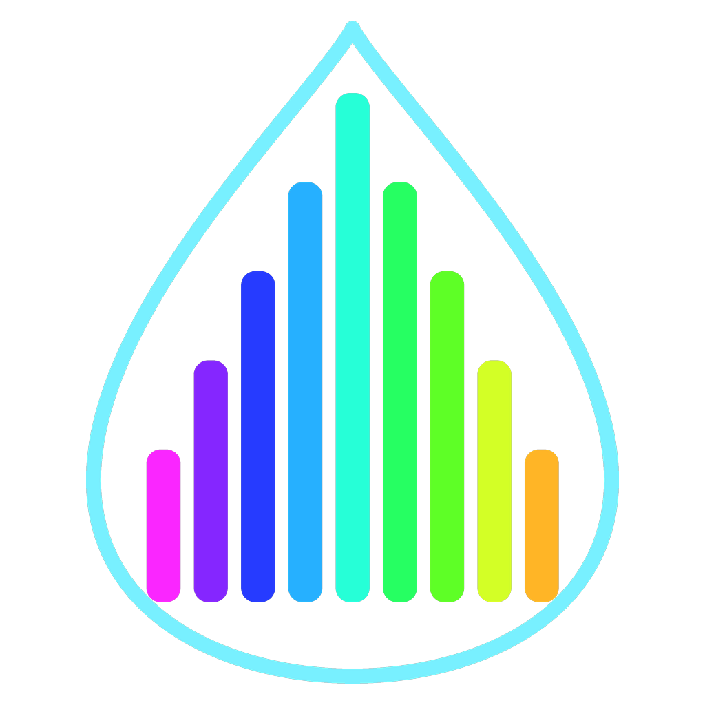</p>

# Dropocalypse

<p align="center"><b>The drop hits. Your logo goes off.</b></p>

<p align="center">Make your logo dance to the beat. <b>Free music visualizer</b> for DJs, streamers &amp; venues. Record clips for <b>TikTok, Reels &amp; YouTube</b>. Mac, Windows &amp; Linux.</p>

<p align="center">
  <a href="https://github.com/allenrobberson/dropocalypse/releases/latest"></a>
  &nbsp;
  <a href="https://github.com/allenrobberson/dropocalypse/releases/latest"></a>
  &nbsp;
  <a href="https://github.com/allenrobberson/dropocalypse/releases/latest"></a>
  &nbsp;
  <a href="https://apps.microsoft.com/detail/9N1TJ9D5R5C8"></a>
</p>

<p align="center">
  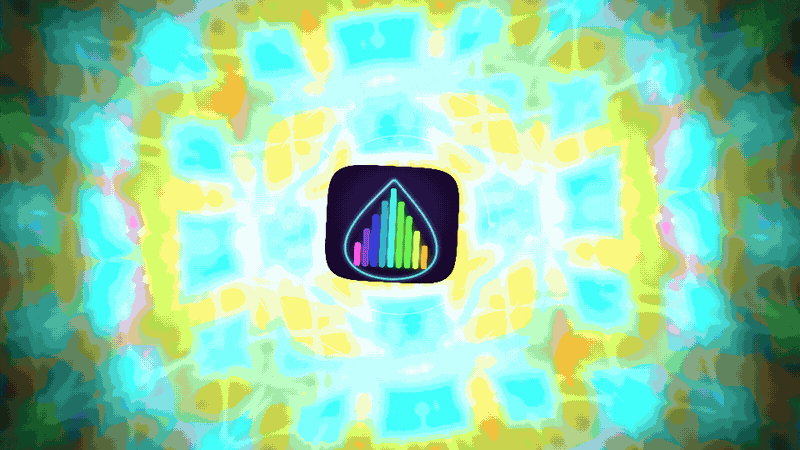
</p>
<p align="center"><sub>Full Kaleidoscope → Spectrum Skyline → Starburst → Liquid Plasma → Vortex → Portrait (9:16).</sub></p>

<table>
  <tr>
    <td align="center" width="20%"><a href="docs/media/styles/classic-tunnel.gif">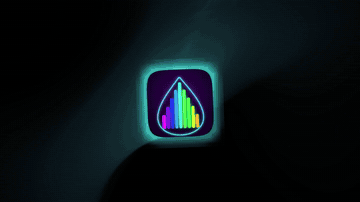</a><br><sub><b>Classic Tunnel</b></sub></td>
    <td align="center" width="20%"><a href="docs/media/styles/spectrum-skyline.gif">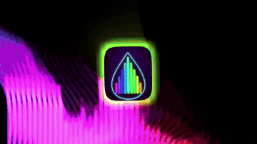</a><br><sub><b>Spectrum Skyline</b></sub></td>
    <td align="center" width="20%"><a href="docs/media/styles/starburst.gif">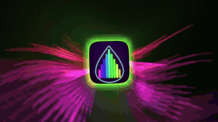</a><br><sub><b>Starburst</b></sub></td>
    <td align="center" width="20%"><a href="docs/media/styles/oscilloscope-drift.gif">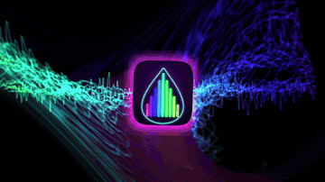</a><br><sub><b>Oscilloscope Drift</b></sub></td>
    <td align="center" width="20%"><a href="docs/media/styles/kaleido-bloom.gif">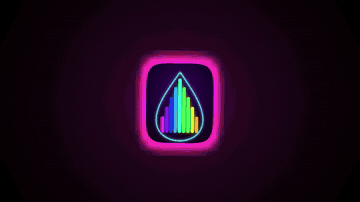</a><br><sub><b>Kaleido Bloom</b></sub></td>
  </tr>
  <tr>
    <td align="center"><a href="docs/media/styles/liquid-plasma.gif">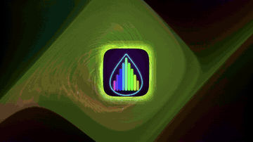</a><br><sub><b>Liquid Plasma</b></sub></td>
    <td align="center"><a href="docs/media/styles/vortex.gif">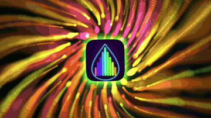</a><br><sub><b>Vortex</b></sub></td>
    <td align="center"><a href="docs/media/styles/lissajous-neon.gif">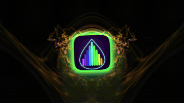</a><br><sub><b>Lissajous Neon</b></sub></td>
    <td align="center"><a href="docs/media/styles/mirror-hall.gif">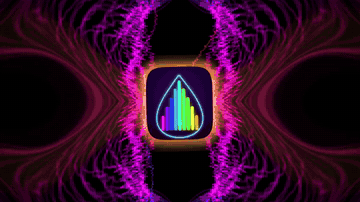</a><br><sub><b>Mirror Hall</b></sub></td>
    <td align="center"><a href="docs/media/styles/black-hole.gif">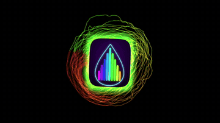</a><br><sub><b>Black Hole</b></sub></td>
  </tr>
  <tr>
    <td align="center"><a href="docs/media/styles/bass-ring.gif">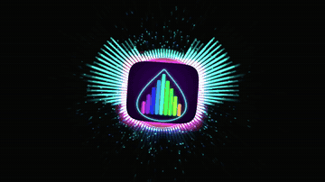</a><br><sub><b>Bass Ring</b></sub></td>
    <td align="center"><a href="docs/media/styles/neon-equalizer.gif">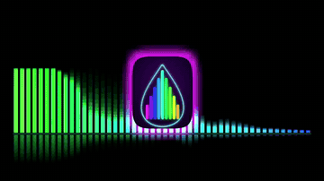</a><br><sub><b>Neon Equalizer</b></sub></td>
    <td align="center"><a href="docs/media/styles/pulsar-ridges.gif">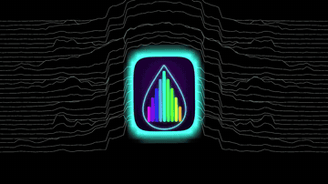</a><br><sub><b>Pulsar Ridges</b></sub></td>
    <td align="center"><a href="docs/media/styles/outrun-grid.gif">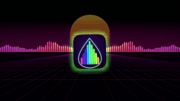</a><br><sub><b>Outrun Grid</b></sub></td>
    <td align="center"><a href="docs/media/styles/hyperspace.gif">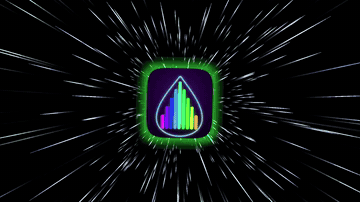</a><br><sub><b>Hyperspace</b></sub></td>
  </tr>
  <tr>
    <td align="center"><a href="docs/media/styles/particle-storm.gif">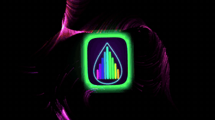</a><br><sub><b>Particle Storm</b></sub></td>
    <td align="center"><a href="docs/media/styles/lightning-storm.gif">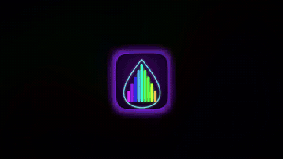</a><br><sub><b>Lightning Storm</b></sub></td>
    <td align="center"><a href="docs/media/styles/digital-rain.gif">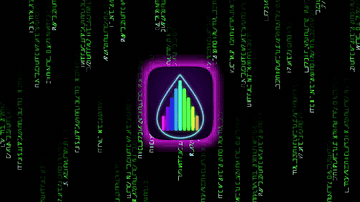</a><br><sub><b>Digital Rain</b></sub></td>
    <td align="center"><a href="docs/media/styles/lava-lamp.gif">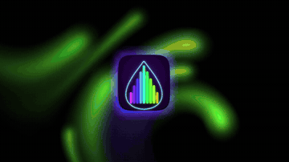</a><br><sub><b>Lava Lamp</b></sub></td>
    <td align="center"><a href="docs/media/styles/inferno.gif">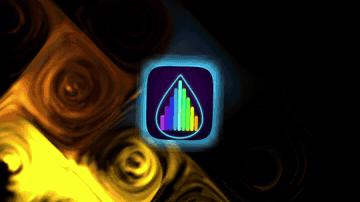</a><br><sub><b>Inferno</b></sub></td>
  </tr>
  <tr>
    <td align="center"><a href="docs/media/styles/mirror-equalizer.gif">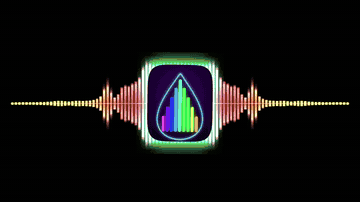</a><br><sub><b>Mirror Equalizer</b></sub></td>
    <td align="center"><a href="docs/media/styles/led-meter.gif">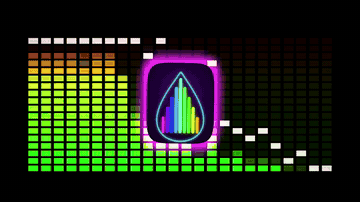</a><br><sub><b>LED Meter</b></sub></td>
    <td align="center"><a href="docs/media/styles/rainbow-peaks.gif">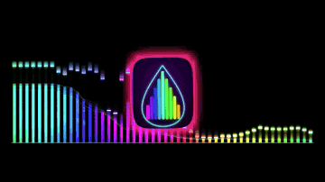</a><br><sub><b>Rainbow Peaks</b></sub></td>
    <td align="center"><a href="docs/media/styles/tesseract.gif">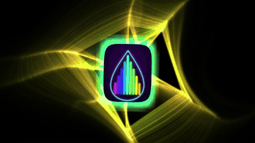</a><br><sub><b>Tesseract</b></sub></td>
    <td align="center"><a href="docs/media/styles/full-kaleidoscope.gif">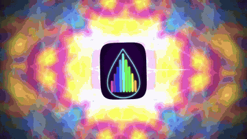</a><br><sub><b>Full Kaleidoscope</b></sub></td>
  </tr>
  <tr>
    <td align="center"><a href="docs/media/styles/main-stage.gif">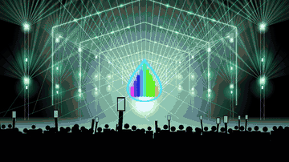</a><br><sub><b>Main Stage</b></sub></td>
    <td align="center"><a href="docs/media/styles/monstercat-bars.gif">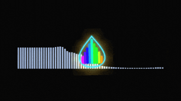</a><br><sub><b>Monstercat Bars</b></sub></td>
    <td align="center"><a href="docs/media/styles/lo-fi-chill.gif">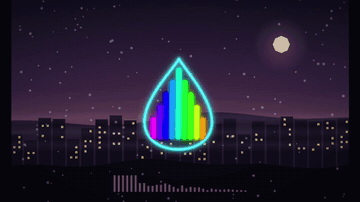</a><br><sub><b>Lo-fi Chill</b></sub></td>
    <td align="center"><a href="docs/media/styles/glitch-vhs.gif">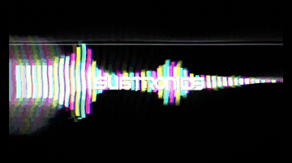</a><br><sub><b>Glitch VHS</b></sub></td>
    <td align="center"><a href="docs/media/styles/liquid-chrome.gif">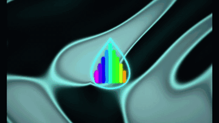</a><br><sub><b>Liquid Chrome</b></sub></td>
  </tr>
  <tr>
    <td align="center"><a href="docs/media/styles/kinetic-text.gif">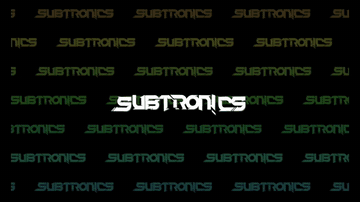</a><br><sub><b>Kinetic Text</b></sub></td>
    <td align="center"><a href="docs/media/styles/logo-layers.gif">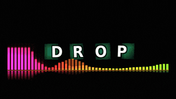</a><br><sub><b>Logo layers (Explode)</b></sub></td>
  </tr>
</table>

<p align="center"><b>MilkDrop presets</b> (built in, played by projectM)</p>

<table>
  <tr>
    <td align="center"><a href="docs/media/styles/milk-acid-mandala.gif">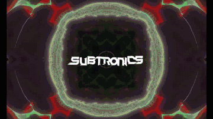</a><br><sub><b>Acid Mandala</b></sub></td>
    <td align="center"><a href="docs/media/styles/milk-flame-face.gif">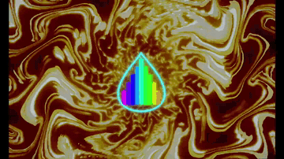</a><br><sub><b>Flame Face</b></sub></td>
    <td align="center"><a href="docs/media/styles/milk-mind-blob.gif">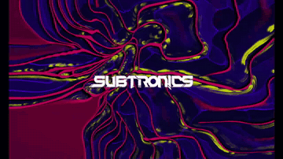</a><br><sub><b>Mind Blob</b></sub></td>
    <td align="center"><a href="docs/media/styles/milk-geiss-lightning.gif">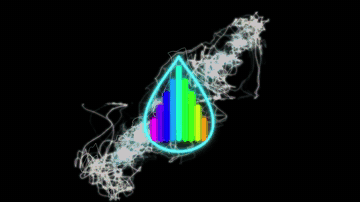</a><br><sub><b>Geiss Lightning</b></sub></td>
    <td align="center"><a href="docs/media/styles/milk-dark-galaxy.gif">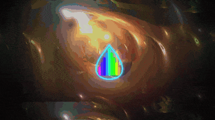</a><br><sub><b>Dark Galaxy</b></sub></td>
  </tr>
  <tr>
    <td align="center"><a href="docs/media/styles/milk-hypraxis.gif">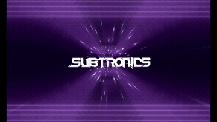</a><br><sub><b>Hypraxis</b></sub></td>
    <td align="center"><a href="docs/media/styles/milk-planar-travel.gif">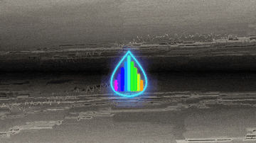</a><br><sub><b>Planar Travel</b></sub></td>
    <td align="center"><a href="docs/media/styles/milk-box-of-tricks.gif">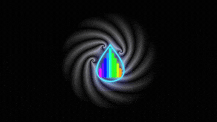</a><br><sub><b>Box of Tricks</b></sub></td>
    <td align="center"><a href="docs/media/styles/milk-lorenz-chaser.gif">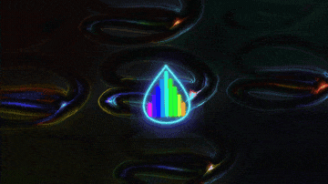</a><br><sub><b>Lorenz Chaser</b></sub></td>
  </tr>
</table>

<p align="center"><sub>All 31 styles, logo layers and the 9 built-in MilkDrop presets. All recorded in the Mac app with real music playing (Main Stage is rendered from the same drawing code). The first 26 use the app icon as the logo; the newer ones use a wordmark split into logo layers (Explode), so its letters fly apart on the beat. Want phone-shaped video? There's also a <a href="docs/media/styles/portrait-frame.jpg">9:16 portrait frame</a>.</sub></p>

A free, open-source, Winamp / MilkDrop-style music visualizer for **Mac, Windows and Linux** that **makes your logo dance to the bass**.

Play music and the visuals swirl, zoom and pulse. It listens straight to what your computer is playing (Spotify, Apple Music, YouTube, DJ software: no mic needed), or through a microphone or line-in. Your logo sits on top and **pulses, squashes and stretches, bounces, slides and wobbles** on every kick drum.

- 🎛 **26 built-in visual styles**: 10 Winamp/MilkDrop-style originals, 10 takes on the most-loved visualizer looks (a bass ring around your logo, neon equalizer bars, ridgelines, a synthwave grid, hyperspace, a particle storm, lightning, digital rain, a lava lamp and flames), plus 3 more equalizers (mirrored, LED meter and rainbow peaks), a 4D Tesseract, **Full Kaleidoscope** (a full-frame neon mandala), **Main Stage** (the view from an arena floor, with cathedral-style beam vaults, lasers and a crowd) and five trending looks: **Monstercat Bars, Lo-fi Chill, Glitch VHS, Liquid Chrome** and **Kinetic Text**. Pick one or let them auto-cycle with smooth crossfades.
- 🌀 **MilkDrop presets**: 9 classic presets built in, played by the open-source projectM engine, and you can **point it at your own folder of `.milk` files** to add thousands more.
- 🖼 **Your logos and text**: up to 4 at once, side by side (or stacked in Portrait). Drag images onto the window, or add text in your choice of font and color. Transparent PNGs look best. Everything is remembered between launches.
- 🥁 **Bass-driven motion**: separate sliders for pulse, squash & stretch, bounce, slide and wobble, plus glow, tint and "logo trails" that feed the logo into the visuals.
- ⚡ **Low latency**: roughly 10–20 ms from sound to screen (see [How it stays fast](#how-it-stays-fast)).
- 🎚 **Any source**: pick **any app on your Mac** (Spotify, Music, a browser…) or **all Mac audio** from a drop-down (macOS 14.2+), **what the computer is playing** on Windows and Linux, or a built-in mic, USB mic, audio interface or line-in.
- 🖥 **Edge-to-edge full screen** that covers every pixel (even beside the MacBook notch), with an auto-hiding toolbar along the top edge, kept clear of the notch, for projectors, TVs and DJ booths.
- 🖥️🖥️ **Two screens**: detach the controls into their own window on your laptop and send the visuals full screen to a TV, projector or second monitor.
- 🔴 **Record videos**: save the visuals and the music as an MP4 (720p, 1080p or 4K) to share on YouTube, Instagram or TikTok. **Portrait** records a 9:16 frame (720×1280, 1080×1920 or 2160×3840) for Reels and TikToks.
- ⬇ **One-click updates**: the **Updates** menu tells you when a new version is out, checks the download, and installs it for you.
- 🔏 **Signed and notarized Mac app** that opens without a security warning, and a **[Microsoft Store edition](https://apps.microsoft.com/detail/9N1TJ9D5R5C8)** signed by Microsoft.

**→ [What's new](#-whats-new) · [Download](#download) · [User guide](#user-guide) · [Printable PDF guide](https://github.com/allenrobberson/dropocalypse/releases/latest/download/Dropocalypse-User-Guide.pdf) · [Wiki](../../wiki) · [Discussions](../../discussions) · [Privacy](PRIVACY.md) · [Code signing policy](CODE_SIGNING_POLICY.md) · [Build from source](#building-from-source)**

<p align="center">
  <a href="https://github.com/sponsors/allenrobberson"></a>
</p>
<p align="center">
  <b>💖 Dropocalypse is free and open source. If it makes your shows, streams or parties better, please <a href="https://github.com/sponsors/allenrobberson">become a sponsor</a>.</b><br>
  Sponsorships keep the project going: they cover the yearly Apple Developer membership that lets Mac downloads open without a security warning, and the time that goes into new styles and features.
</p>

## 🆕 What's new

### 1.6.4: style timer in the style list
- ⏱ **Change style every** is now at the very top of the style list (click the style name), with the Auto-cycle switch right under it. The Auto key no longer has its own right-click menu.

### 1.6.3: AppImage updates
- 🐧 **Linux AppImage**: now named `Dropocalypse-<version>-x86_64.AppImage` and carries update information, so AppImageUpdate and similar tools can update it. On Linux 1.6.2 or older, download 1.6.3 once from the [latest release](../../releases/latest); after that, Update now works again.

**[See every update in the Changelog →](../../wiki/Changelog)**

## Download

Get every version from the **[latest release](../../releases/latest)**. Each release includes:

| File | For |
|---|---|
| `Dropocalypse-…-macOS.dmg` | Mac (drag-to-Applications installer) |
| `Dropocalypse-…-macOS.zip` | Mac (the app in a zip, same thing) |
| `Dropocalypse-…-Windows-portable.zip` | Windows 10/11, 64-bit, no install, updates from GitHub |
| `Dropocalypse-…-x86_64.AppImage` | Linux, 64-bit, one file, updates from GitHub or with AppImageUpdate |
| `Dropocalypse-…-Linux-x86_64.tar.gz` | Linux, the same app as a plain folder |
| [`Dropocalypse-User-Guide.pdf`](https://github.com/allenrobberson/dropocalypse/releases/latest/download/Dropocalypse-User-Guide.pdf) | A printable, full-color guide for Mac, Windows and Linux |

On Windows you can also **[get it from the Microsoft Store](https://apps.microsoft.com/detail/9N1TJ9D5R5C8)**. From 1.0 on, the app updates itself in one click when a newer version is out. Want an email for each release? Click **Watch → Custom → Releases** at the top of this page.

### 🍎 Mac

1. Download the `macOS.dmg`, open it, and drag **Dropocalypse** into **Applications**.
2. **Open it.** Dropocalypse is signed and notarized by Apple (since 1.0.1), so it opens like any other app with no security warning.
   - Still on a version before 1.0.1? macOS may block it the first time. On macOS 15 Sequoia and later, try to open it once, then click **Open Anyway** in **System Settings → Privacy & Security**; on macOS 13–14, right-click the app → **Open** → **Open**. Updating to the latest version fixes this for good.
3. Click **Audio** in the toolbar and choose what to listen to: an app like **Spotify** or **All Mac audio** (macOS 14.2+), or a mic or line-in. macOS asks once for permission: *system audio recording* for apps, *microphone* for a mic. Audio is analyzed live and never sent anywhere; it's only saved if you press **Record**, and then only to your own computer.

Requires macOS 13 Ventura or later on an Apple Silicon or Intel Mac.

### 🪟 Windows

> 💡 **Want to skip the security warning?** **[Get Dropocalypse from the Microsoft Store](https://apps.microsoft.com/detail/9N1TJ9D5R5C8)**. The Store edition is already signed by Microsoft, so Windows opens it without a "Windows protected your PC" warning, and the Store keeps it up to date. The portable zip below isn't code-signed yet.

**Portable zip** (no install, no admin rights):

1. Download the `Windows-portable.zip`, right-click it → **Extract All**, and open the folder.
2. Double-click **Dropocalypse.exe**. Nothing gets installed, and you can keep the folder anywhere, even on a USB stick.
3. **First launch:** if Windows says *"Windows protected your PC"*, click **More info → Run anyway**. This happens because the portable download isn't code-signed yet. The [Microsoft Store edition](https://apps.microsoft.com/detail/9N1TJ9D5R5C8) doesn't show this warning.
4. By default it listens to **what your PC is playing** (Spotify, YouTube, DJ software), so you don't need a microphone. To use a mic or line-in, pick it under **Audio** in the toolbar. For a mic, turn on **Settings → Privacy & security → Microphone → Let desktop apps access your microphone**.

The [Microsoft Store edition](https://apps.microsoft.com/detail/9N1TJ9D5R5C8) is updated by the Store, so it has no **Update now**; the portable zip updates itself from GitHub. Both keep your logos and settings in `%APPDATA%\Dropocalypse`.

Requires Windows 10 or 11 (64-bit). Settings and your logo are saved in `%APPDATA%\Dropocalypse`. To remove the app, delete that folder and the app folder.

### 🐧 Linux (AppImage: one file, nothing to install)

1. Download the `x86_64.AppImage`.
2. Make it executable: right-click it → **Properties** → **Allow executing file as program**, or run `chmod +x Dropocalypse-*.AppImage` in a terminal.
3. Double-click it (or run `./Dropocalypse-*.AppImage`).
4. By default it listens to **what the computer is playing**, so you don't need a microphone. Pick a specific output, a mic or a line-in under **Audio** in the toolbar.

Works on 64-bit Ubuntu 22.04 or later, Debian 12, Fedora, Linux Mint, Arch and other current distributions, with X11 or Wayland and PulseAudio or PipeWire (through `pipewire-pulse`, which current desktops include). Graphics need OpenGL 3.3, which every GPU from the last decade supports.

- **Recording** to MP4 uses **ffmpeg**: install it with your package manager (for example `sudo apt install ffmpeg`).
- **Choosing a logo or folder** uses the desktop's file chooser (zenity or kdialog, usually already installed). You can always drag an image onto the window instead.
- Prefer a plain folder? Download the `Linux-x86_64.tar.gz` and run `./dropocalypse` from it (it needs libcurl and libpulse, which nearly every desktop has).

Settings and your logo are saved in `~/.config/dropocalypse`. **Update now** in the **Updates** menu replaces the AppImage in place. To remove the app, delete the AppImage and that folder.

## User guide

- [Quick start](#quick-start)
- [The toolbar](#the-toolbar)
- [Logos and text](#logos-and-text)
- [Style controls](#style-controls)
- [Motion panel](#motion-panel)
- [Logo panel](#logo-panel)
- [Audio panel](#audio-panel)
- [Look panel](#look-panel)
- [The 31 styles](#the-31-styles)
- [MilkDrop presets](#milkdrop-presets)
- [Keyboard shortcuts and menus](#keyboard-shortcuts-and-menus)
- [Setting up for a live show](#setting-up-for-a-live-show)
- [Troubleshooting](#troubleshooting)

### Quick start

1. Open **Dropocalypse** and play some music. On Windows and Linux it already listens to what the computer is playing. On a Mac, click **Audio** in the toolbar and pick the app you're playing music from (for example **Spotify**), and allow access when macOS asks. A mic or line-in works on all three.
2. The visuals start reacting right away.
3. Drag your logo onto the window, or press **L** to pick a file. A PNG with a transparent background looks best. Want more? Add up to 4 logos, or text, from the **Logo menu**.
4. Press **F** for full screen.

Your logo, style and all settings are saved automatically and come back the next time you open the app.

### The toolbar

Every control lives in one slim bar along the **top edge** of the window.

- **To show it:** move the mouse toward the top of the screen, click anywhere, or press **T**.
- **It hides itself** after about 2.5 seconds without activity, and the mouse cursor hides with it, leaving a clean picture.
- **It stays open** while your pointer is over it or while one of its menus is open.
- **To hide it right away:** press **Esc**.

From left to right:

| Control | What it does |
|---|---|
| **‹** · **Style name** · **›** | Previous style, open the style list, next style. In the list, click a name to show it, and use the **checkboxes** to choose which styles auto-cycle rotates through |
| ⟳ **Auto** | Turns auto-cycle on or off. It glows green while auto-cycle is on. Set how long each style stays up (5 seconds to 6 minutes) with **Change style every** at the top of the style list (click the style name) |
| **Logo** | Opens the [Logo menu](#logos-and-text): your logos and text items, plus size, glow, tint and trails |
| **Motion** | Opens the [Motion menu](#motion-panel): how the logo reacts to the bass |
| **Audio** | Opens the [Audio menu](#audio-panel): what to listen to (an app, all Mac audio, a mic or line-in) and sensitivity. It turns red when audio isn't running. |
| **Look** | Opens the [Look menu](#look-panel): beat flash, brightness, landscape or portrait, frame rate |
| ● **Record** / ■ **Stop** | Red while recording, with the running time. Records the visuals and the music to an MP4 video. The **▾** next to it sets the video size and where to save. See [Recording](#recording). |
| *Status text* | The input being used, its sample rate and the audio buffer size (lower ms = faster reaction) |
| **Detach** | Moves the controls into their own window, stacked top to bottom, so they can stay on your laptop while the visuals go on a TV or projector. See [Two screens](#two-screens-controls-on-one-visuals-on-the-other). |
| **Screen** | Picks the display that shows the visuals full screen (TV, projector, second monitor), and turns full screen on or off (also **F**) |
| **Updates** | Your version, **Check now** and **Check for updates automatically**. When a newer version is out it turns pink and reads **Update X.Y.Z**: **Update now** checks the download and, if the checks pass, installs it and reopens. Your logo and settings are kept. If a check fails, nothing is changed. **Download page** gets it yourself, or **Ignore for 24 hours**. Also in the detached controls window. |
| **Keys** | Shows the keyboard shortcuts |

**On small screens the menus become letters.** When the window is too narrow for the full names (a 720p projector, a small laptop, a narrowed window), the menus show one letter each:

| Letter | Menu |
|---|---|
| **L** | Logo |
| **M** | Motion |
| **A** | Audio |
| **V** | Look ("visuals"; L is already Logo) |
| **S** | Screen |
| **U** | Updates |
| **?** | Keys |

Hold the mouse over a letter to see its name; the open menu shows its full name as its title. **Detach** always shows the whole word so it's easy to find. When there's room again, the full names come back by themselves. The letters are only on the toolbar: the keyboard shortcuts don't change.

Every button is drawn as a raised key and every slider as a mixer fader, the same on Mac, Windows and Linux. A pink key has its menu open; the **Auto** key glows green while auto-cycle is on.

> In full screen on a MacBook with a camera notch, the toolbar sits just below the notch so no button hides behind it, while the visuals still fill the whole screen.

### Logos and text

Show **up to 4 logos and text items at once**. In landscape they sit side by side, left to right; in **Portrait** (Look menu) they stack top to bottom. Each one shrinks to fit its space, and **Size** in the Logo menu sets them all. They all react to the same beat, each with a small offset in timing and direction so they don't move like clones.

The **Logo menu** in the toolbar lists your items:

| Item | What it does |
|---|---|
| **1. band.png**, **2. "DJ NIGHT"** … | Each item, with **Replace…** (images), the **‹ ›** keys to move it (up / down in Portrait) and **Remove** |
| **Add Logo… / Add image… (L)** | Adds an image. PNGs with a transparent background look best. Empty transparent edges are trimmed automatically so each logo bounces around its visible shape. |
| **Add Text** | Adds a text item. Type the words right in the list. |
| **Remove all** | Removes every item (Mac: **File → Remove All Logos**) and goes back to the "YOUR LOGO" placeholder |
| **Show Logos (G)** | Hides or shows them all without removing them, so you get visuals only |

**Text items:** type the words (up to 60 characters), pick a font (**Bold**, **Heavy**, **Serif** or **Mono**) and a color (white, pink, cyan, gold, lime or purple). Text gets a dark outline so it stays readable over bright visuals, and glows, tints and trails like a logo. Edit text and reorder items in the **Logo** menu, or in the detached controls window.

You can also **drag images** from Finder, File Explorer, your file manager or a web browser onto the window at any time. Drop several to add them all. When all 4 spaces are used, a dropped image replaces the last item.

**Logo layers:** raise any of the **Wave**, **Explode**, **Bands** or **Scatter** sliders in the [Motion panel](#motion-panel) (0 = still, 100 = super wild) and each logo is split into its separate shapes, which move on the beat on their own. A shape is any part that doesn't touch another, so a logo with spaced-out letters, or a text item, splits letter by letter; a solid badge stays in one piece. Tiny specks join the nearest shape, and a logo is split into at most 24 layers.

### Style controls

| Control | What it does |
|---|---|
| **‹** / **›** | Previous / next style. You can also use the ← → arrow keys. |
| **Style name** | Opens the style list. Click a name to jump straight to any of the [31 styles](#the-31-styles). The **checkbox** to the left of each style decides whether auto-cycle includes it. **All** and **None** check or clear every box at once. |
| ⟳ **Auto** | When on, the app moves to the next **checked** style every 30 seconds (adjustable from 5 seconds to 6 minutes with **Change style every** at the top of the style list), with a smooth 2.5-second crossfade. Unchecked styles are skipped; if nothing is checked, it uses every style. Choosing a style by hand restarts the timer, and the arrows and arrow keys still reach every style. |

### Motion panel

These sliders control how your logo reacts to the bass. **0 turns a motion off completely**; the highest setting is 1.5. The four **Logo layers** sliders at the bottom go from 0 to 100.

<p align="center">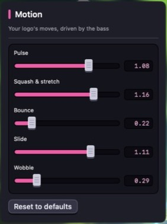<br><sub>The Motion menu, with the Logo layers sliders at the bottom</sub></p>

| Slider | Default | What it does |
|---|---|---|
| **Pulse** | 0.70 | The logo grows with the bass and shrinks back as it fades. This is the most direct "breathing" motion. |
| **Squash & stretch** | 0.60 | On each kick the logo squashes wide and short, then springs back like rubber. Also stretches it taller during sustained bass. |
| **Bounce** | 0.50 | Kicks launch the logo upward and it falls back with gravity. A small squash happens when it lands. |
| **Slide** | 0.40 | Each beat pushes the logo left or right, alternating sides, and a spring pulls it back to center. Adds a slow side-to-side drift too. |
| **Wobble** | 0.35 | Each beat tips the logo into a quick rotation that settles back to level |
| **Wave** (logo layers) | 0 | The shapes hop one after another from left to right. 0 = still, 100 = super wild (at the top they also flip). |
| **Explode** (logo layers) | 0 | The shapes burst outward from the centre and spring back. Higher values also fire on softer beats. |
| **Bands** (logo layers) | 0 | Each shape rides the bass, mids or treble, rising and growing with its part of the music. |
| **Scatter** (logo layers) | 0 | Every shape flies off in its own direction and spins. |
| **Reset to defaults** | | Puts the Motion, Logo and Look sliders back to their defaults |

The four **logo layers** sliders split your logo into its separate shapes (each letter, icon or piece that doesn't touch another) and move them on their own. They go from 0 (still) to 100 (super wild), and you can mix as many as you like. They work on images and text items.

<table>
  <tr>
    <td align="center">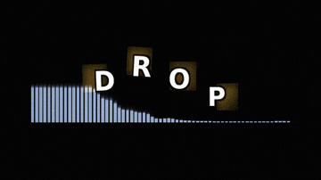<br><sub><b>Wave</b> 75</sub></td>
    <td align="center">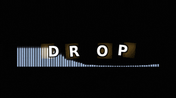<br><sub><b>Explode</b> 85</sub></td>
  </tr>
  <tr>
    <td align="center">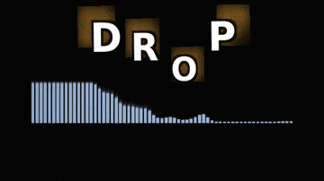<br><sub><b>Bands</b> 85</sub></td>
    <td align="center">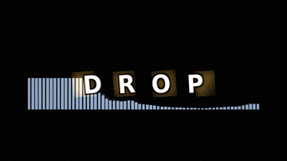<br><sub><b>Scatter</b> 80</sub></td>
  </tr>
</table>

> **Tip:** for a calm, branded look, try Pulse 0.5 and everything else at 0. For a festival-style "everything goes off" look, push Squash, Bounce and Wobble to 1.2 or higher.

### Logo panel

These sit under the list of items in the **Logo** menu, and in the detached controls window.

| Control | Default | What it does |
|---|---|---|
| **Size** | 0.32 | How big the logo is, as a fraction of the screen height (0.08 to 0.8). The longer side of the logo is fitted to this size. |
| **Glow** | 0.60 | A soft, colored halo behind the logo that flares brighter with the bass. 0 turns it off. |
| **Color tint** | 0.00 | Blends the logo toward the current style's color. 0 keeps your logo's original colors; 1 recolors it completely. |
| **Logo trails** | Off | Feeds a faint copy of the logo into the visuals every frame, so it leaves echoes that swirl, zoom and fade with the effect |
| **Show logos (G)** | On | Hides or shows every logo and text item without removing them |

### Audio panel

| Control | Default | What it does |
|---|---|---|
| **Listen to** (Mac) | System default input | A drop-down of everything you can listen to. **Mac audio** (macOS 14.2+): *All Mac audio*, or any open app such as **Spotify**, Music, Safari or Chrome. Apps playing right now are listed first and marked ♪. Dropocalypse hears exactly what that app plays, at full quality, with no mic or extra software. If the app hasn't played anything yet, it starts the moment it does. **Microphone or line-in**: built-in mic, USB mic, audio interface or line-in. |
| **Input** (Windows) | System audio | *System audio (what this PC is playing)* listens directly to the PC's sound output, so no mic is needed, and *Playing on: …* listens to one specific output device. You can also pick a mic, audio interface or line-in. |
| **Input** (Linux) | What this computer is playing | Listens to the default output through PulseAudio or PipeWire, so no mic is needed. *Playing on: …* listens to one specific output. You can also pick a mic, audio interface or line-in. |
| **Refresh list** (Windows: **Refresh devices**) | | Updates the list after you open an app or plug something in |
| **Restart audio** | | Restarts listening. Use it if the visuals stop reacting after a device change or sleep. |
| **Sensitivity** | 1.00 | How easily quiet audio drives the visuals (0.2 to 4). Raise it in a quiet room or when the mic is far from the speakers. Lower it if room noise makes things twitch when no music is playing. |
| **Beat threshold** | 1.35× | How much the bass has to jump above its recent average to count as a "beat" for squash, bounce, slide, wobble and flash (1.1× to 2.2×). **Lower = more beats**, so it reacts to more of the music. **Higher = only big kicks** count. |
| *Status line* | | The active input, sample rate and buffer size, or a message if something is wrong |

The app adjusts its own levels to the loudness of the input (automatic gain), so it works with both a quiet room mic and a hot line-level signal without manual tweaking.

### Look panel

| Control | Default | What it does |
|---|---|---|
| **Beat flash** | 0.40 | The whole screen brightens briefly on each beat. 0 turns it off. |
| **Brightness** | 1.00 | Overall brightness of the visuals (0.4 to 1.6). Lower it for dark rooms or bright projectors. |
| **Frame** | Landscape | **Landscape** fills the window. **Portrait** centers a 9:16 frame (pillarboxed on a wide screen) so what you see is what a Reel or TikTok recording captures. It can't be changed while a recording is in progress. |
| **Frame rate** | Display | **Display** matches the monitor. **60** and **30** use less CPU. |

### The 31 styles

| # | Style | Preview | What it looks like |
|---|---|---|---|
| 1 | **Classic Tunnel** |  | The waveform bursts out of the center and streams outward into an endless, slowly twisting tunnel. The classic Winamp look. |
| 2 | **Spectrum Skyline** |  | Spectrum bars along the bottom, with trails that rise up the screen like smoke |
| 3 | **Starburst** |  | Rays shoot straight out of the center, one per frequency band, and explode outward on the bass |
| 4 | **Oscilloscope Drift** |  | A glowing horizontal waveform that ripples, rotates slowly and leaves drifting trails |
| 5 | **Kaleido Bloom** |  | A six-way kaleidoscope that blooms outward from the center, spinning faster with the bass |
| 6 | **Liquid Plasma** |  | Flowing, liquid plasma colors with waveform rings melting into them |
| 7 | **Vortex** |  | A three-armed spiral of dots that whips around the center, flinging trails outward in a fast spin |
| 8 | **Lissajous Neon** |  | A mirrored neon scribble drawn by the sound wave itself; smooth tones make loops, noisy sounds make chaos |
| 9 | **Mirror Hall** |  | Two vertical waveforms reflected four ways into an infinite hall of mirrors |
| 10 | **Black Hole** |  | Everything is pulled inward and spirals down into the center |

**Classic favorites:** our own versions of the visualizer looks people love most, from YouTube music channels to iTunes and synthwave.

| # | Style | Preview | What it looks like |
|---|---|---|---|
| 11 | **Bass Ring** |  | A circular spectrum that wraps around your logo and follows it, with sparks bursting off on every kick. It sizes itself to your logo automatically. |
| 12 | **Neon Equalizer** |  | Smooth neon spectrum bars across the screen with a glassy reflection underneath |
| 13 | **Pulsar Ridges** |  | Stacked white ridgelines that span the full width of the screen and scroll upward, with the bass rising in the middle: the classic "joy plot" look |
| 14 | **Outrun Grid** |  | A synthwave sunset: smooth striped sun, a full-width spectrum meter on the horizon in sunset colors, and a neon grid floor that races toward you faster when the bass hits |
| 15 | **Hyperspace** |  | A starfield that jumps to warp speed on the drops |
| 16 | **Particle Storm** |  | Hundreds of glowing particles flowing in currents around the logo, scattering outward on every beat |
| 17 | **Lightning Storm** |  | Lightning bolts crack out from behind the logo on the beat, over a stormy plasma sky |
| 18 | **Digital Rain** |  | Columns of glowing green glyphs raining down, falling faster with the bass |
| 19 | **Lava Lamp** |  | Big soft blobs of color drifting and melting into each other, swelling with the bass |
| 20 | **Inferno** |  | Embers and flames rising from the bottom of the screen, flaring up with each frequency band |

**Equalizer family:** three more takes on Neon Equalizer.

| # | Style | Preview | What it looks like |
|---|---|---|---|
| 21 | **Mirror Equalizer** |  | Bars grow up and down from a glowing center line, bass in the middle and highs at the edges, in a sunset rainbow (pink → orange → gold) |
| 22 | **LED Meter** |  | A classic hardware spectrum analyzer: segmented LEDs from green through yellow to red, with peak markers that hang and then drop |
| 23 | **Rainbow Peaks** |  | Thin bars cycling through the rainbow, with glowing caps that the bass knocks into the air and that fall back with gravity |

**4D:**

| # | Style | Preview | What it looks like |
|---|---|---|---|
| 24 | **Tesseract** |  | A glowing neon hypercube (a 4D cube) rotating through the fourth dimension, so the inner cube keeps turning itself inside out through the outer one. It spins harder on every beat, swells with the bass and leaves light trails. Tip: a smaller logo **Size** lets you see the inner cube. |

**Kaleidoscope:**

| # | Style | Preview | What it looks like |
|---|---|---|---|
| 25 | **Full Kaleidoscope** |  | A mandala that fills the whole frame. Strong 4-way mirroring that sometimes tightens into an 8-way radial pattern, in saturated neon cyan, magenta, electric blue, gold and acid green, with glowing midtones and darker edges. Bass zooms, pulses and turns it; mids and highs change the color and detail. |
| 26 | **Main Stage** |  | Stand on an arena floor. Truss columns run back to a stage of glowing LED frames, and fans of moving-head beams meet overhead like a cathedral ceiling, blooming open on every kick. Lasers spray from the stage on the beat and scan the crowd, blinders flash, and a crowd with phones up bounces to the bass. The lighting changes look every 8 beats: amber, teal, lavender lasers and deep blue. |

**Trending looks:** five styles that are everywhere on music channels and socials right now.

| # | Style | Preview | What it looks like |
|---|---|---|---|
| 27 | **Monstercat Bars** |  | A tidy row of smooth, pale spectrum bars above the logo that leap up on the bass and glide back down: the look of electronic music channels on YouTube |
| 28 | **Lo-fi Chill** |  | A quiet night town under a big glowing moon, with lit windows, drifting fog, falling snow and a small soft equalizer along the bottom. The moon's halo breathes with the bass. |
| 29 | **Glitch VHS** |  | A neon spectrum and a sweeping scan line on worn videotape. On every beat the picture tears into sideways bands, splits into colour fringes and wobbles, with scanlines and grain throughout. |
| 30 | **Liquid Chrome** |  | Flowing, polished liquid metal reflecting a bright studio sky. It swells and ripples with the bass and slowly shifts colour. |
| 31 | **Kinetic Text** |  | Rows of your first logo or text item slide across the screen in alternating directions, faster with the bass. The row the beat lands on lights up and grows. Add your DJ name as a text item for a lyric-video look. |

### MilkDrop presets

After the built-in styles comes a **MilkDrop** section with 9 classic presets, played by the open-source [projectM](https://github.com/projectM-visualizer/projectm) engine: **Acid Mandala, Flame Face, Mind Blob, Geiss Lightning, Dark Galaxy, Hypraxis, Planar Travel, Box of Tricks** and **Lorenz Chaser**. They crossfade in and out like every other style and can be checked for auto-cycle.

<table>
  <tr>
    <td align="center"><br><sub><b>Acid Mandala</b></sub></td>
    <td align="center"><br><sub><b>Flame Face</b></sub></td>
    <td align="center"><br><sub><b>Mind Blob</b></sub></td>
  </tr>
  <tr>
    <td align="center"><br><sub><b>Geiss Lightning</b></sub></td>
    <td align="center"><br><sub><b>Dark Galaxy</b></sub></td>
    <td align="center"><br><sub><b>Hypraxis</b></sub></td>
  </tr>
  <tr>
    <td align="center"><br><sub><b>Planar Travel</b></sub></td>
    <td align="center"><br><sub><b>Box of Tricks</b></sub></td>
    <td align="center"><br><sub><b>Lorenz Chaser</b></sub></td>
  </tr>
</table>

**Add your own:** open the style list and, under **Your MilkDrop presets**, click **Choose folder** and pick a folder of `.milk` files (subfolders are searched too). Each preset becomes a style you can search for and click. **Rescan** picks up new files, **Open** shows the folder and **Remove** forgets it. Your own presets stay out of auto-cycle unless you turn on **Include these presets in auto-cycle**, so a pack of thousands won't take over a show. Download the 9 bundled presets as a zip from the [milkdrop folder](https://github.com/allenrobberson/dropocalypse/tree/main/milkdrop) on GitHub.

All styles react to the bass. Most also zoom, spin or ripple harder as it builds, and the mids add extra warp.

> **Tip:** **Bass Ring** and **Particle Storm** are built around a centered logo, so try turning **Bounce** and **Slide** down so the logo stays put. For **Pulsar Ridges** and **Outrun Grid**, a smaller **Size** (around 0.2) keeps the logo from covering the scene.

### Keyboard shortcuts and menus

| Key | Action |
|---|---|
| `F` | Full screen on / off |
| `T` or `S` | Show / hide the toolbar |
| `Esc` | Hide the toolbar; press again to exit full screen |
| `⌃⌘F` | Full screen (Mac menu shortcut; the green window button works too) |
| `F11` | Full screen (Windows and Linux) |
| `Ctrl+O` | Add a logo (Windows and Linux) |
| `Ctrl+Q` | Quit (Linux) |
| `L` | Add a logo |
| `G` | Show / hide the logos |
| `←` `→` | Previous / next style |
| `A` | Auto-cycle on / off |
| `D` | Detach / attach the controls window |
| `R` | Start / stop recording |

On the Mac, the menu bar has the same actions: **File → Add Logo… (⌘O)**, **Add Text** and **Remove All Logos**, and **Visualizer → Next Style (⌘→), Previous Style (⌘←), Full Screen (⌃⌘F), Show/Hide Toolbar (⌘,), Detach Controls (⇧⌘D), Start/Stop Recording (⇧⌘R), Restart Audio**, plus **Dropocalypse → Check for Updates…**.

### Recording a video
1. Click **Record** in the toolbar (or press **R**). It turns red and becomes **Stop** with a running timer.
2. Play your music. Dropocalypse records the visuals (without the toolbar) together with the music it's listening to.
3. Click **Stop** (or press **R** again). A moment later you'll see **Saved Dropocalypse 2026-11-15 at 19.30.00.mp4** with a button to show it in Finder, File Explorer or your file manager.

Open the **▾** next to Record to choose the **video size** (720p or 1080p at 60 fps, or 4K at 30 fps) and **where to save**: your Movies folder (Mac) or Videos folder (Windows and Linux) unless you pick another. On Linux, recording needs **ffmpeg**. Recordings are MP4 files (H.264 video, AAC audio) that play anywhere and upload straight to YouTube, Instagram or TikTok. In **Landscape** (the Look panel), if your window isn't 16:9 the video gets black bars; full screen on a 16:9 display fills the frame. **Portrait** records a vertical 9:16 frame instead: 720×1280, 1080×1920 or 2160×3840. On a landscape screen the same frame is centered with black bars on either side, so the preview matches the file.

### Two screens: controls on one, visuals on the other
1. Click **Detach** in the toolbar (or press **D**). The controls move into their own **Dropocalypse Controls** window, stacked top to bottom, with every panel shown in place.
2. Under **Visuals**, pick your TV, projector or second monitor from the screen list. The visuals go full screen there.
3. Keep the controls window on your main screen and change styles, logo, motion and audio while the show runs. Your audience only sees the visuals.
4. Click **Attach controls to the visuals** (or close the controls window) to put the toolbar back on top. Dropocalypse remembers which way you left it.

### Setting up for a live show

1. **Playing from the same computer?** On a Mac, pick your music or DJ app (or *All Mac audio*) under **Audio → Listen to**. On Windows, pick *System audio*; on Linux, the default already listens to what the computer is playing. It's the cleanest signal there is, with no cables or mic.
2. **Use a direct feed if you can.** Run the booth, record or aux output of your mixer or DJ controller into a USB audio interface, then pick that interface under **Audio**. A direct feed reacts more cleanly than a mic hearing a loud room.
3. **Using a mic instead?** Point it toward the speakers or subwoofer. Raise **Sensitivity** if the room is quiet; lower it if crowd noise is driving the visuals.
4. **Tune the beat.** Watch the logo during a track with a clear kick. If it misses kicks, lower **Beat threshold**. If it jumps on hi-hats or vocals, raise it.
5. **Go full screen** on the projector or TV: drag the window onto that screen and press **F**, or **Detach** the controls and pick the screen so you can keep adjusting things from your laptop (see [Two screens](#two-screens-controls-on-one-visuals-on-the-other)). In landscape, full screen covers every pixel, edge to edge: the Mac's menu bar and Dock are hidden, and on MacBooks with a camera notch the visuals fill the strip beside the notch too. In portrait, full screen centers the 9:16 frame and leaves the sides black.
6. Turn **auto-cycle** on so the show keeps changing without you touching it: 30 to 60 seconds per style keeps things lively, and up to 6 minutes suits a slower, ambient night. Uncheck any styles in the style list that don't fit the night.
7. **Want a clip of the night?** Press **R** to record the visuals and the music, and **R** again to stop.

### Troubleshooting

| Problem | Fix |
|---|---|
| **Mac: "Dropocalypse can't be opened"** on first launch | Download the latest version: since 1.0.1 the Mac app is signed and notarized and opens normally. On an older version, see [Download → Mac](#-mac). |
| **Windows: "Windows protected your PC"** | Click **More info → Run anyway**. The portable download isn't code-signed yet. The [Microsoft Store edition](https://apps.microsoft.com/detail/9N1TJ9D5R5C8) is signed by Microsoft and skips this warning. |
| **Windows: nothing happens when I double-click** | Make sure you extracted the zip first; don't run the app from inside it. On work or school PCs, IT policies can block unapproved apps, so ask your IT team. |
| **Windows: visuals don't react to Spotify / YouTube** | Under **Audio**, choose *System audio (what this PC is playing)*. If you use headphones and speakers, pick the *Playing on: …* entry for the device you're listening on. |
| **Windows: another app can't play while Dropocalypse is open** | Fixed in 1.2.9. Windows Media Player used to say it encountered a problem while playing the file. Open **Updates** and click **Update now**. System audio only listens, in shared mode, and the status line shows a buffer of about 10 ms. |
| **Windows: two copies stay open after Update now** | Fixed in 1.2.10. Update now closes the old Dropocalypse before the new one starts. If you still see two, quit both in Task Manager and open the app once. Starting it again while it is already open brings that window forward. |
| **Linux: the AppImage won't start** | Make it executable (**Properties → Allow executing file as program**, or `chmod +x`). On Ubuntu 22.04 or older, a message about FUSE means you need `libfuse2`, or run it with `--appimage-extract-and-run`. |
| **Linux: visuals don't react to the music** | Under **Audio**, pick *What this computer is playing* or the *Playing on: …* entry for the output you're listening on, then click **Restart audio**. It needs PulseAudio or PipeWire (with `pipewire-pulse`, which current desktops include). |
| **Linux: Record says ffmpeg is missing** | Install ffmpeg with your package manager, for example `sudo apt install ffmpeg`, then press **Record** again. |
| **Nothing reacts when listening to an app** (Mac) | Make sure the app is actually playing, then allow Dropocalypse in **System Settings → Privacy & Security → Screen & System Audio Recording** (under *System Audio Recording Only*) and click **Restart audio**. Needs macOS 14.2 or later. |
| **Nothing reacts to the music** | Check that microphone access is on. **Mac:** System Settings → Privacy & Security → Microphone → Dropocalypse. **Windows:** Settings → Privacy & security → Microphone → *Let desktop apps access your microphone*. Then use **Audio → Restart audio** and make sure the right input is selected. |
| **It reacts, but only a little** | Raise **Sensitivity** and lower **Beat threshold**. Check that the input's level isn't turned down in **System Settings → Sound → Input**. |
| **It twitches when no music is playing** | Lower **Sensitivity**, or switch to a direct line-in feed |
| **My USB interface or app isn't listed** | Plug it in or open the app, then click **Refresh list** (Windows: **Refresh devices**) in the Audio panel |
| **Visuals stutter for the first few minutes** (Mac, with a microphone) | Fixed in 1.2.2. Click **Updates → Update now**. |
| **Update now doesn't work**, or the Updates menu says the download wasn't installed | Nothing was changed. The **Updates** menu is in the toolbar (and the detached controls window). Mac: keep Dropocalypse in **Applications**. The new app must be signed with the same Developer ID and accepted by Gatekeeper. Windows: keep the folder somewhere you can edit, such as Documents or Desktop. Once this copy is code-signed, the download must be signed by the same publisher. Or use **Download page**. |
| **I can't find my recording** | It's in your **Movies** (Mac) or **Videos** (Windows and Linux) folder unless you chose another one under **Record ▾**. Click the **Show** button in the message after you stop. |
| **Recording has black bars** | The video is 16:9. Go full screen on a 16:9 display, or make the window 16:9, to fill the frame. |
| **My logo looks blurry** | Use a larger image; around 1000 px on the long side is ideal |
| **My logo has a white box around it** | The image has a solid background. Export it as a PNG with a transparent background. |
| **The MilkDrop styles are missing** | The style list says the MilkDrop engine isn't available. Download the full app again from the [latest release](../../releases/latest): the engine ships beside the app (in the app bundle on Mac, next to the `.exe` on Windows, next to the program on Linux). Copying only the `.exe` or program file leaves it behind. |
| **My own MilkDrop presets don't show up** | Check the folder actually holds `.milk` files, then click **Rescan**. Presets that use pictures need their collection's `Textures` folder next to the presets folder. A few very old presets don't work in projectM and show a plain picture. |
| **The logo layers sliders do nothing** | Your logo is one connected shape (for example a badge with a solid background), so there is nothing to split. Try a PNG with a transparent background and separate letters, or a text item. |
| **The toolbar won't appear** | Move the mouse to the very top of the window, click anywhere, or press **T** |
| **Settings or logo reset after updating from "Logo Visualizer"** | The app was renamed. Your saved logo is copied over automatically, but slider settings start fresh, and macOS asks for microphone permission again. |

## How it stays fast

Most visualizers feel laggy because of how they listen and analyze. This one:

1. **Reads each hardware audio buffer directly** with `AVAudioSinkNode` (or a Core Audio process tap for app audio) and asks Core Audio for 128-frame buffers (about 2.7 ms). The common `installTap` approach delivers audio in 100–400 ms chunks.
2. **Tracks bass sample by sample** using a 4th-order 140 Hz low-pass filter and an envelope follower with a 1 ms attack. Logo motion never waits for an FFT window to fill. The FFT is only used for drawing spectrum bars.
3. **Jumps instantly on a hit and only smooths the release.** On each detected beat, part of the logo's squash, bounce, slide and wobble is applied on that very frame, and stiff, damped springs carry the follow-through, so the motion peaks on the kick instead of a few frames later.
4. **Renders at the display's refresh rate**, up to 120 Hz on ProMotion. It reads the newest audio values right before each frame and uses only two drawables to avoid an extra frame of queueing.

On Windows the same design uses **WASAPI** in shared mode, and the capture thread is registered with MMCSS ("Pro Audio") so it isn't starved. Microphones and line-ins use `IAudioClient3` to ask for the smallest period on that **input** only. **System audio** is loopback capture of the output the PC is already playing: the mix format, and the engine's normal period (about 10 ms). Dropocalypse does not open a playback stream and does not change that output's period or format, so other programs keep playing. Rendering uses a flip-model **Direct3D 11** swap chain with a frame-latency waitable object and a maximum latency of one frame.

On Linux it listens through **PulseAudio** (or PipeWire's PulseAudio service) in 5 ms fragments, records the output's *monitor* for what the computer is playing, and draws with **OpenGL 3.3** using the same shaders, ported to GLSL.

## Building from source

```bash
git clone https://github.com/allenrobberson/dropocalypse.git
cd dropocalypse
swift run -c release            # quick run
./scripts/build-app.sh          # builds dist/Dropocalypse.app, .zip and .dmg
```

You need Xcode 15 or later (or the Command Line Tools) on macOS 13 or later. The app itself has no third-party dependencies. The MilkDrop styles need the projectM engine: run `scripts/build-projectm.sh` (needs CMake) once and `build-app.sh` copies it into the app. Without it the app still runs, just without the MilkDrop styles.

**Windows** (Visual Studio 2022 with the "Desktop development with C++" workload, plus CMake):

```powershell
cmake -S windows -B build -A x64
cmake --build build --config Release
build\Release\Dropocalypse.exe
```

The Windows build downloads [Dear ImGui](https://github.com/ocornut/imgui) (MIT) for the toolbar and links the C runtime statically, so the `.exe` runs without installing anything. For the MilkDrop styles, run `scripts\build-projectm.ps1` and copy the projectM DLL next to `Dropocalypse.exe`.

**Linux** (GCC or Clang, CMake, and the development packages for OpenGL, PulseAudio, libcurl, X11 and Wayland):

```bash
sudo apt install build-essential cmake pkg-config libgl-dev libpulse-dev libcurl4-openssl-dev \
  libx11-dev libxrandr-dev libxinerama-dev libxcursor-dev libxi-dev libwayland-dev libxkbcommon-dev wayland-protocols
cmake -S linux -B build-linux -DCMAKE_BUILD_TYPE=Release
cmake --build build-linux
./build-linux/dropocalypse
```

The Linux build downloads Dear ImGui, [GLFW](https://www.glfw.org) (zlib) and [stb](https://github.com/nothings/stb) (public domain). For the MilkDrop styles, run `scripts/build-projectm.sh` and copy `build/projectm/lib/libprojectM-4.so*` next to the program. It shares the styles, the update rules and the toolbar with the Windows version: after changing the Windows toolbar code, run `python3 linux/port/generate.py` to bring the Linux toolbar up to date.

**Releases are automatic.** GitHub Actions builds every push to `main`. To publish a new downloadable version, do either of these:
- On GitHub, go to **Actions → Build → Run workflow**, type a version such as `0.2.0`, and click **Run workflow**.
- Or push a tag: `git tag v0.2.0 && git push origin v0.2.0`

Either way, the Mac, Windows and Linux versions are built side by side and published together in one GitHub Release.

Before releasing, add the new version to the top of `docs/wiki/Changelog.md` and run `python3 scripts/make-guide.py` (needs `reportlab`). The printable User Guide shows the version on its cover and on every page, taken from the newest changelog entry, and the build warns if the guide's version doesn't match the release.

### Project layout

```
Sources/Dropocalypse/
  Audio/AudioCapture.swift    mic / line-in capture, device list, small hardware buffers
  Audio/ProcessTap.swift      Core Audio process tap: listen to one app or all Mac audio (14.2+)
  Audio/AudioAnalysis.swift   real-time filters, envelopes, auto-gain, beat detection
  Recorder.swift              MP4 recording (AVAssetWriter, H.264 + AAC)
  UpdateChecker.swift         update check, download, verify and one-click install
  Render/Renderer.swift       Metal pipeline: feedback warp → shapes → composite + logo
  Render/ShaderSource.swift   all Metal shaders
  Render/Scenes.swift         the 31 built-in styles (add your own here!)
  Render/StyleFX.swift        particles, stars, lightning, ridges, rain for styles 11-20
  Render/WaveDrawer.swift     waveform / spectrum / dots geometry
  Render/LogoMotion.swift     spring physics for pulse, squash, bounce, slide, wobble
Sources/DropocalypseCore/
  LogoLayers.swift            splits a logo into shapes, layer motion, Kinetic Text rows
  Render/Milkdrop.swift       MilkDrop presets through projectM (loaded at run time)
  Views/                      SwiftUI window, auto-hiding toolbar, detached controls

windows/
  src/audio.cpp               WASAPI capture (mic, line-in, system-audio loopback) + the same DSP
  src/renderer.cpp            Direct3D 11 pipeline, styles, logo physics
  src/scenes.h                the 31 styles (shared by Windows and Linux)
  src/logo_layers.h           splits a logo into shapes, layer motion, Kinetic Text rows
  src/milkdrop.h              MilkDrop preset list, bundled presets, projectM loader
  src/milkdrop_host.cpp       plays a preset through projectM (OpenGL) into Direct3D
  src/shaders.h               HLSL port of the Metal shaders
  src/logo.cpp                logo loading (PNG, JPG, …)
  src/recorder.cpp            MP4 recording (Media Foundation, H.264 + AAC)
  src/main.cpp                windows, swap chains, toolbar, detached controls, updater, settings
  app.manifest                "asInvoker": runs without admin rights

linux/
  src/audio.cpp               PulseAudio / PipeWire capture (outputs and inputs) + the same DSP
  src/renderer.cpp            OpenGL 3.3 pipeline (shared style code from windows/src/renderer.cpp)
  src/shaders.h               GLSL port of the shaders
  src/milkdrop_host.cpp       plays a preset through projectM in a shared OpenGL context
  src/recorder.cpp            MP4 recording through ffmpeg
  src/main.cpp                generated by port/generate.py from the Windows toolbar + port/*.inc
  port/*.inc                  Linux parts: GLFW windows, file dialogs, AppImage updater, main loop

milkdrop/                     the 9 bundled presets, their texture, credits and a downloadable zip
```

### Adding a style

Add a `VisualScene(...)` entry to `VisualScene.builtIn` in `Scenes.swift` (Mac) and the matching entry in `windows/src/scenes.h`, which the Windows and Linux versions share. Each style is a handful of numbers: zoom, rotation, warp, trail decay, mirror and kaleidoscope settings, wave style and colors. Pull requests with new styles are very welcome.

## Roadmap

- [x] Load MilkDrop `.milk` presets through [projectM](https://github.com/projectM-visualizer/projectm) (LGPL), including your own folder of presets
- [x] Windows version (portable, no admin rights)
- [x] Capture the PC's own audio output without a microphone (Windows)
- [x] Linux version (AppImage), including listening to what the computer plays
- [x] Capture the Mac's own audio output (Spotify, YouTube…) without a microphone (macOS 14.2+)
- [x] Several logos and text items at once
- [ ] Syphon / NDI output for VJ software
- [x] Update notifications and one-click updates inside the app
- [x] App icon
- [x] Signed and notarized Mac builds
- [x] Detachable controls and a screen picker for two-screen shows
- [x] Record videos with sound
- [ ] Code-signed portable Windows builds (the Microsoft Store copy is signed by Microsoft)
- [ ] Mac App Store edition (in review)

## Questions, ideas and bug reports

- 💬 **[Discussions](../../discussions)**: ask questions, suggest new styles, or show off your setup and logo.
- 🐞 **[Issues](../../issues)**: report a bug. Please include your OS version, which style you were on, and your audio input.

## Support the project

Dropocalypse is free and always will be. If it livens up your shows or streams, consider **[sponsoring it on GitHub](https://github.com/sponsors/allenrobberson)**. Sponsorships cover the yearly $99 Apple Developer membership that keeps Mac downloads signed and notarized, and the time spent on new styles and features.

## Privacy and code signing

- **[Privacy Policy](PRIVACY.md):** your audio never leaves your computer, and recordings are only made when you press **Record** and saved only to the folder you choose. The only network use is a daily update check with GitHub (which you can turn off in the **Updates** menu) and downloading an update when you click **Update now**.
- **[Code signing policy](CODE_SIGNING_POLICY.md):** the Mac app is signed and notarized by Apple, and the [Microsoft Store edition](https://apps.microsoft.com/detail/9N1TJ9D5R5C8) is signed by Microsoft. The portable Windows zip is not code-signed yet; every download is built by GitHub Actions from this public code and listed with its SHA-256 checksum.

## License

[MIT](LICENSE): free to use, modify and share, including commercially.

Inspired by Ryan Geiss's MilkDrop and Nullsoft's Winamp. The 31 built-in styles are original code. The MilkDrop styles play through [projectM](https://github.com/projectM-visualizer/projectm) (LGPL 2.1), shipped as a separate library beside the app that you can replace with your own build; the 9 bundled presets belong to their authors, listed in [milkdrop/CREDITS.md](milkdrop/CREDITS.md). No Shadertoy shaders are bundled. The Windows and Linux toolbars use [Dear ImGui](https://github.com/ocornut/imgui) (MIT); the Linux version also uses [GLFW](https://www.glfw.org) (zlib) and [stb](https://github.com/nothings/stb).
