# Styles

See every style moving in the [animated gallery on the GitHub page](https://github.com/allenrobberson/dropocalypse#readme).

| # | Style | Preview | What it looks like |
|---|---|---|---|
| 1 | **Classic Tunnel** | 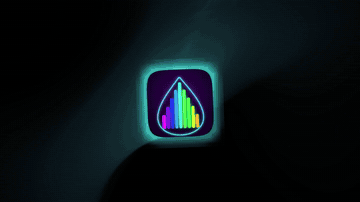 | The waveform bursts out of the center and streams outward into an endless, slowly twisting tunnel. The classic Winamp look. |
| 2 | **Spectrum Skyline** | 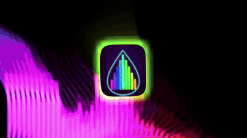 | Spectrum bars along the bottom, with trails that rise up the screen like smoke |
| 3 | **Starburst** | 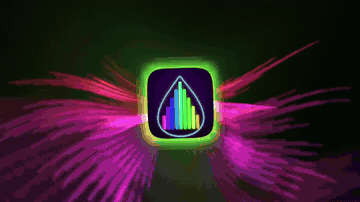 | Rays shoot straight out of the center, one per frequency band, and explode outward on the bass |
| 4 | **Oscilloscope Drift** | 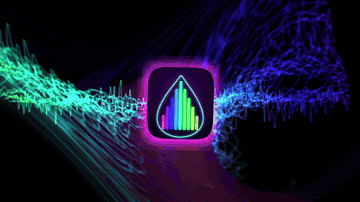 | A glowing horizontal waveform that ripples, rotates slowly and leaves drifting trails |
| 5 | **Kaleido Bloom** | 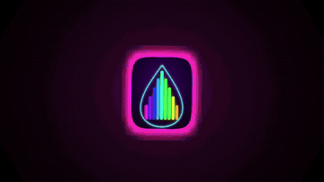 | A six-way kaleidoscope that blooms outward from the center, spinning faster with the bass |
| 6 | **Liquid Plasma** | 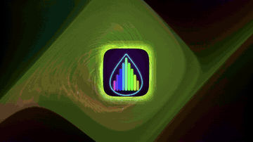 | Flowing, liquid plasma colors with waveform rings melting into them |
| 7 | **Vortex** | 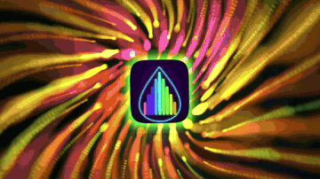 | A three-armed spiral of dots that whips around the center, flinging trails outward in a fast spin |
| 8 | **Lissajous Neon** | 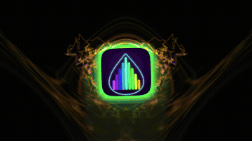 | A mirrored neon scribble drawn by the sound wave itself; smooth tones make loops, noisy sounds make chaos |
| 9 | **Mirror Hall** | 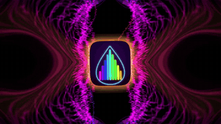 | Two vertical waveforms reflected four ways into an infinite hall of mirrors |
| 10 | **Black Hole** | 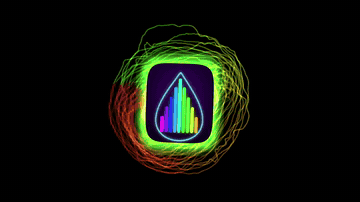 | Everything is pulled inward and spirals down into the center |

**Classic favorites:** our own versions of the visualizer looks people love most, from YouTube music channels to iTunes and synthwave.

| # | Style | Preview | What it looks like |
|---|---|---|---|
| 11 | **Bass Ring** | 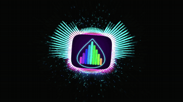 | A circular spectrum that wraps around your logo and follows it, with sparks bursting off on every kick. It sizes itself to your logo automatically. |
| 12 | **Neon Equalizer** | 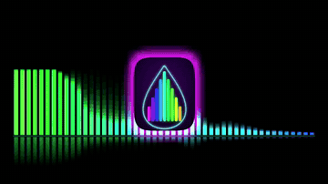 | Smooth neon spectrum bars across the screen with a glassy reflection underneath |
| 13 | **Pulsar Ridges** | 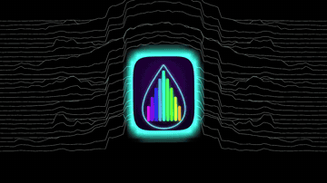 | Stacked white ridgelines that span the full width of the screen and scroll upward, with the bass rising in the middle: the classic "joy plot" look |
| 14 | **Outrun Grid** | 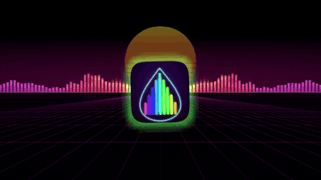 | A synthwave sunset: smooth striped sun, a full-width spectrum meter on the horizon in sunset colors, and a neon grid floor that races toward you faster when the bass hits |
| 15 | **Hyperspace** | 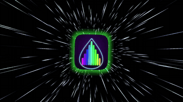 | A starfield that jumps to warp speed on the drops |
| 16 | **Particle Storm** | 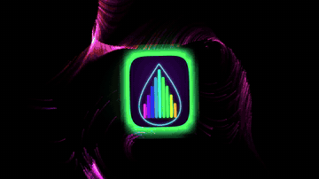 | Hundreds of glowing particles flowing in currents around the logo, scattering outward on every beat |
| 17 | **Lightning Storm** | 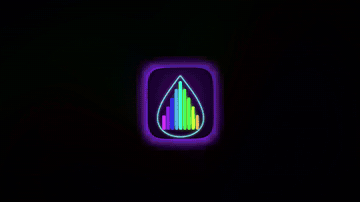 | Lightning bolts crack out from behind the logo on the beat, over a stormy plasma sky |
| 18 | **Digital Rain** | 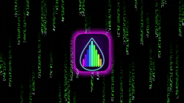 | Columns of glowing green glyphs raining down, falling faster with the bass |
| 19 | **Lava Lamp** | 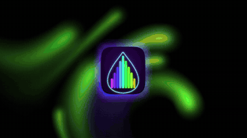 | Big soft blobs of color drifting and melting into each other, swelling with the bass |
| 20 | **Inferno** | 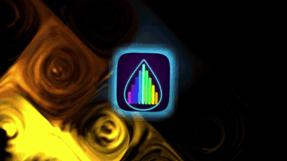 | Embers and flames rising from the bottom of the screen, flaring up with each frequency band |

**Equalizer family:** three more takes on Neon Equalizer.

| # | Style | Preview | What it looks like |
|---|---|---|---|
| 21 | **Mirror Equalizer** | 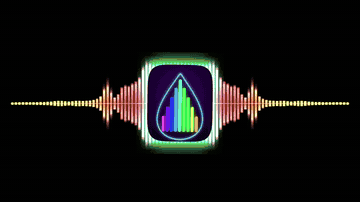 | Bars grow up and down from a glowing center line, bass in the middle and highs at the edges, in a sunset rainbow (pink → orange → gold) |
| 22 | **LED Meter** | 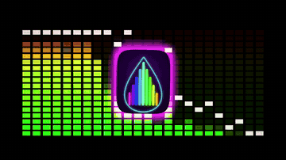 | A classic hardware spectrum analyzer: segmented LEDs from green through yellow to red, with peak markers that hang and then drop |
| 23 | **Rainbow Peaks** | 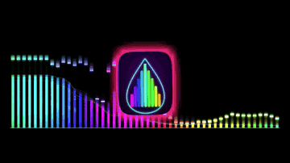 | Thin bars cycling through the rainbow, with glowing caps that the bass knocks into the air and that fall back with gravity |

**4D:**

| # | Style | Preview | What it looks like |
|---|---|---|---|
| 24 | **Tesseract** | 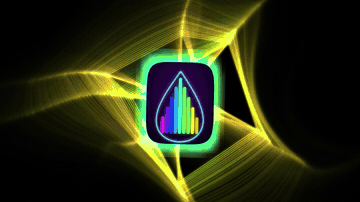 | A glowing neon hypercube (a 4D cube) rotating through the fourth dimension, so the inner cube keeps turning itself inside out through the outer one. It spins harder on every beat, swells with the bass and leaves light trails. Tip: a smaller logo **Size** lets you see the inner cube. |

**Kaleidoscope:**

| # | Style | Preview | What it looks like |
|---|---|---|---|
| 25 | **Full Kaleidoscope** | 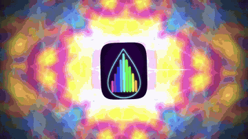 | A mandala that fills the whole frame. Strong 4-way mirroring that sometimes tightens into an 8-way radial pattern, in saturated neon cyan, magenta, electric blue, gold and acid green, with glowing midtones and darker edges. Bass zooms, pulses and turns it; mids and highs change the color and detail. |
| 26 | **Main Stage** | 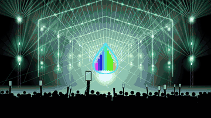 | Stand on an arena floor. Truss columns run back to a stage of glowing LED frames, and fans of moving-head beams meet overhead like a cathedral ceiling, blooming open on every kick. Lasers spray from the stage on the beat and scan the crowd, blinders flash, and a crowd with phones up bounces to the bass. The lighting changes look every 8 beats: amber, teal, lavender lasers and deep blue. |

**Trending looks:** five styles that are everywhere on music channels and socials right now.

| # | Style | Preview | What it looks like |
|---|---|---|---|
| 27 | **Monstercat Bars** | 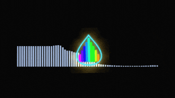 | A tidy row of smooth, pale spectrum bars above the logo that leap up on the bass and glide back down: the look of electronic music channels on YouTube |
| 28 | **Lo-fi Chill** | 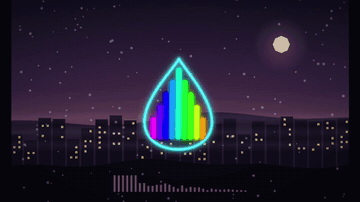 | A quiet night town under a big glowing moon, with lit windows, drifting fog, falling snow and a small soft equalizer along the bottom. The moon's halo breathes with the bass. |
| 29 | **Glitch VHS** | 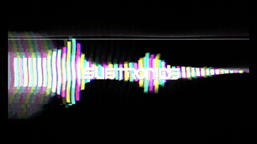 | A neon spectrum and a sweeping scan line on worn videotape. On every beat the picture tears into sideways bands, splits into colour fringes and wobbles, with scanlines and grain throughout. |
| 30 | **Liquid Chrome** | 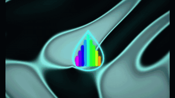 | Flowing, polished liquid metal reflecting a bright studio sky. It swells and ripples with the bass and slowly shifts colour. |
| 31 | **Kinetic Text** | 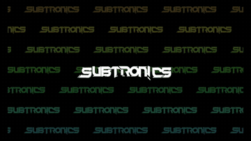 | Rows of your first logo or text item slide across the screen in alternating directions, faster with the bass. The row the beat lands on lights up and grows. Add your DJ name as a text item for a lyric-video look. |

## MilkDrop presets

After the built-in styles comes a **MilkDrop** section with 9 classic presets, played by the open-source [projectM](https://github.com/projectM-visualizer/projectm) engine: **Acid Mandala, Flame Face, Mind Blob, Geiss Lightning, Dark Galaxy, Hypraxis, Planar Travel, Box of Tricks** and **Lorenz Chaser**. They crossfade in and out like every other style and can be checked for auto-cycle.

<table>
  <tr>
    <td align="center">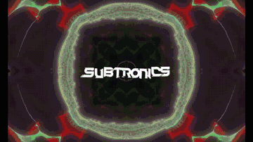 <b>Acid Mandala</b></td>
    <td align="center">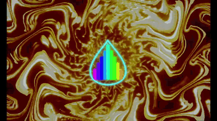 <b>Flame Face</b></td>
    <td align="center">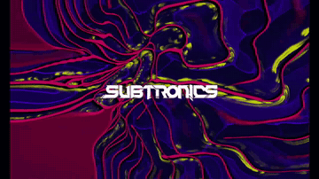 <b>Mind Blob</b></td>
  </tr>
  <tr>
    <td align="center">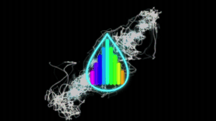 <b>Geiss Lightning</b></td>
    <td align="center">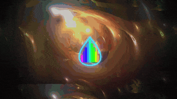 <b>Dark Galaxy</b></td>
    <td align="center">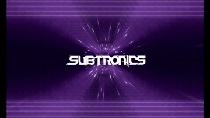 <b>Hypraxis</b></td>
  </tr>
  <tr>
    <td align="center">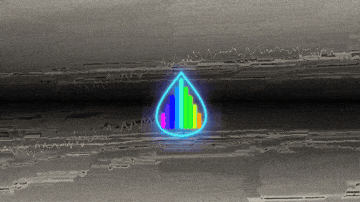 <b>Planar Travel</b></td>
    <td align="center">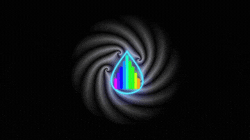 <b>Box of Tricks</b></td>
    <td align="center">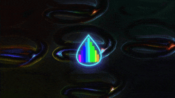 <b>Lorenz Chaser</b></td>
  </tr>
</table>

**Add your own:** open the style list and, under **Your MilkDrop presets**, click **Choose folder** and pick a folder of `.milk` files (subfolders are searched too). Each preset becomes a style you can search for and click. **Rescan** picks up new files, **Open** shows the folder and **Remove** forgets it. Your own presets stay out of auto-cycle unless you turn on **Include these presets in auto-cycle**, so a pack of thousands won't take over a show. Download the 9 bundled presets as a zip from the [milkdrop folder](https://github.com/allenrobberson/dropocalypse/tree/main/milkdrop) on GitHub.

All styles react to the bass. Most also zoom, spin or ripple harder as it builds, and the mids add extra warp.

> **Tip:** **Bass Ring** and **Particle Storm** are built around a centered logo, so try turning **Bounce** and **Slide** down so the logo stays put. For **Pulsar Ridges** and **Outrun Grid**, a smaller **Size** (around 0.2) keeps the logo from covering the scene.

## Choosing styles

- **‹ / ›** in the toolbar, or the **← →** arrow keys, step through every style.
- Click the **style name** to open the style list and click any name to jump to it.

## Auto-cycle and the checkboxes

Turn on **auto-cycle** (the ⟳ **Auto** key in the toolbar, or press **A**) and Dropocalypse moves to the next style on a timer, with a smooth 2.5-second crossfade. Set the timer with **Change style every** at the very top of the style list: click the style name in the toolbar (5 to 360 seconds; 30 s by default). In the detached controls window it's at the top of **Styles and auto-cycle** on Windows and Linux, and in the style list on a Mac.

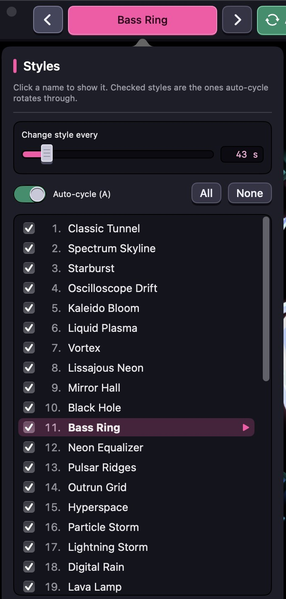 The style list (click the style name). <b>Change style every</b> is at the very top.

The style list has a **checkbox** to the left of every style:

- **Checked** styles are included in auto-cycle; **unchecked** ones are skipped.
- **All** and **None** check or clear every box at once.
- If nothing is checked, auto-cycle uses every style instead of getting stuck.
- The arrows and arrow keys still reach unchecked styles, so you can always pick one by hand.
- Your choices are saved, and styles added in future versions start out checked.

**Example:** for a synthwave night, check only Outrun Grid, Neon Equalizer, Mirror Equalizer, Hyperspace and Tesseract.

Want a new look? See [[Adding a Style]], or suggest one in [Discussions](https://github.com/allenrobberson/dropocalypse/discussions).
